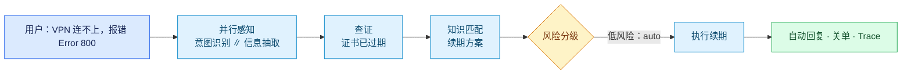
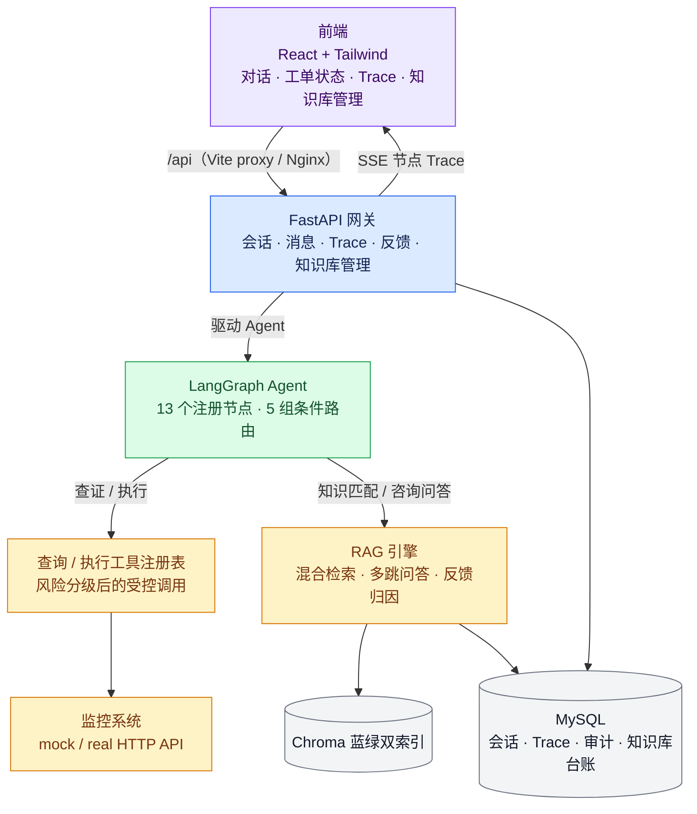
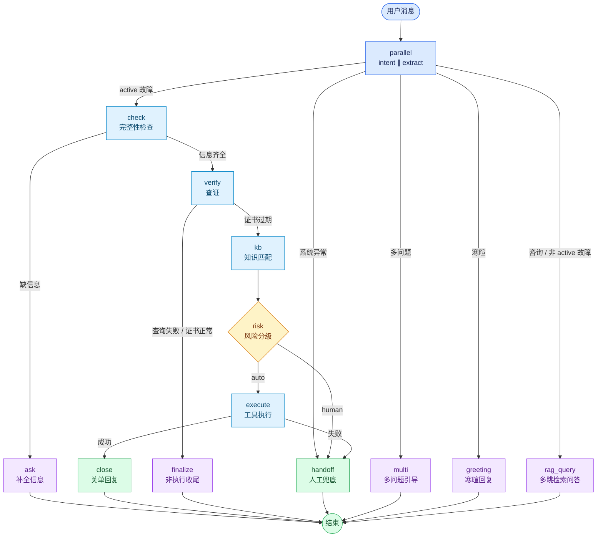
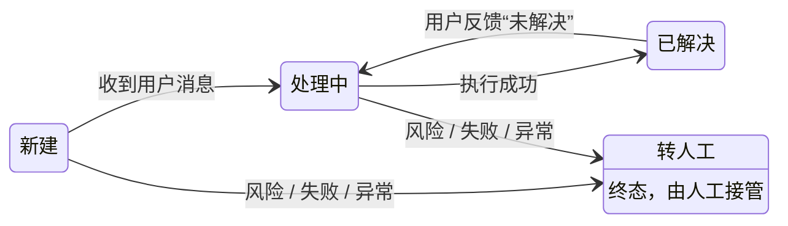
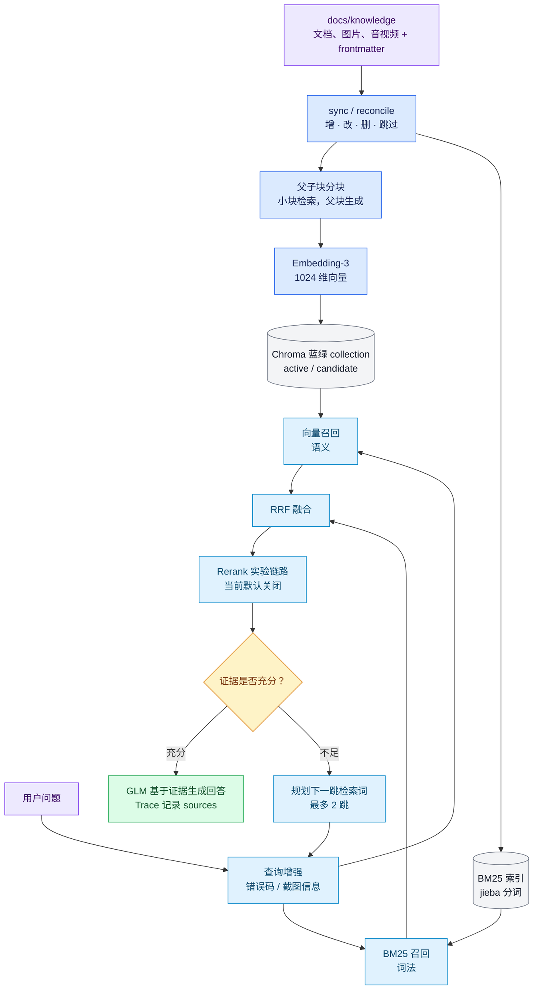

# 智能IT运维服务台（AI IT Helpdesk）

[](https://github.com/sleep-zzz520/AI-IT-Helpdesk/actions/workflows/ci.yml)

> 面向企业 IT 运维场景的 Agent 工程实践：用 **LangGraph 状态机** 编排 VPN 证书续期等工单，验证风险分级、工具执行、知识检索与故障兜底。

已实现风险分级执行、Trace、RAG、多租户与自动评测。当前仍有澄清策略、崩溃恢复和多主机容量方面的限制，尚未完成生产验收。能力范围与实测结果见[本轮质量评测](docs/quality-evaluation-2026-11-01.md)。

## 痛点与解法

**传统 L1 运维**经常需要人工中转：接单 → 模板回复 → 反复追问 → 远程排查。本项目用合成工单验证自动处理流程，尚无真实用户工时对照数据。

**本项目的 Agent 模式**（感知 → 决策 → 执行 全自动闭环）：



L1 工程师全程无感，仅在后台审计日志看到一条成功记录。

## 核心特性

- 🤖 **确定性 Agent 编排**：LangGraph 状态机（节点 + 条件边），流程显式、可观测、可断点
- ⚖️ **风险分级执行**：信任边界（低风险自动、高风险转人工，`RISK_POLICY` 配置）
- 🛠️ **MCP 风格工具链**：查询/执行工具按名字注册（`QUERY_REGISTRY` / `TOOL_REGISTRY`），可插拔；执行类工具是信任边界保护对象（只有过风险分级才允许）
- 📊 **全链路 Trace + 实时推送**：每节点语义化摘要（AI/规则/工具分类 + 状态色）+ 全链路耗时 + **SSE 边跑边推**（前端实时点亮，不"干等"）
- 🖼️ **视觉 OCR**：GLM-4V 从报错截图识别错误码（前端支持粘贴/上传）
- 📈 **Eval 自动化评估**：真实检索 60 题、问答行为 29 题，以及隔离格式/同步回归、84 条门禁对照与本地 HTTP 负载；新报告在 `backend/tests/quality_reports/`，保留失败与未测指标
- 🧩 **场景注册表（数据驱动）**：加新场景 = 填一张表，图代码零改动；启动校验防遗漏
- 🔎 **RAG 混合检索**：BM25（jieba 分词）+ 向量双路召回 → RRF 融合；保留 Rerank 实验链路，当前固定评测退化，默认关闭
- 🧠 **Agentic 多跳检索**：retrieve → judge → 证据不足自动规划下一跳（MAX_HOPS=2，每跳记 Trace）
- 📄 **多模态知识入库**：pdf/docx/pptx/xlsx/图片/音视频 → GLM-4V/GLM-ASR 转译降维（8 类格式统一文本入库）
- 🔄 **蓝绿发布**：候选索引全量重建，构建失败禁止切换；同机发布互斥，旧库未覆盖前可回滚。增量引擎与全量发布入口分开说明
- 🚦 **单机过载保护**：认证前在途请求预算、Agent 执行槽位、同会话互斥；`request_id` 持久去重，终态重放不会再次运行 Agent
- 👍 **反馈闭环**：用户 👍/👎 → 负反馈自动归类（文档缺失 vs 文档过时），反哺知识库运营
- 🏷️ **工单流转状态机**：新建 → 处理中 → 已解决/转人工，显式转移表 + 护栏（非法流转被挡）+ 流转历史留痕
- 🏢 **多租户 + 权限 + 审计**：PBKDF2 密码哈希 + HMAC token + 登录态注入身份（不信任前端传值）；跨租户数据隔离；登录/会话/反馈/知识库操作全审计
- 🔌 **真实监控 API 对接**：`MONITOR_MODE=mock|real` 双模式，real 走 HTTP（超时/重试/错误归一化），换真实系统只改 `MONITOR_BASE_URL`
- 🧩 **用户自定义模型**：登录用户可添加、测试并切换自己的 OpenAI 兼容模型；API Key 加密保存，配置与密钥按用户隔离
- 🧪 **测试工程化**：pytest 一条命令跑全量离线回归（mock LLM + 内存 SQLite），CI 自动验证，改坏流程立刻红
- 📜 **统一日志系统**：logging 级别/文件轮转/结构化格式（时间|级别|模块|消息），容器日志卷持久化——生产排障可查，不再 print 满天飞
- 🧹 **代码规范强制**：后端 ruff + 前端 oxlint，CI 必跑，改坏规范立刻红
- 💾 **备份与恢复**：MySQL 全量备份（在线不锁表、保留 7 份滚动）+ 向量库打包 + 恢复演练脚本，数据可回滚

## 架构图



### Agent 执行状态图

下图对应 `backend/app/agents/graph.py`：**13 个注册节点**，以及 `parallel`、`check`、`verify`、`risk`、`execute` 五组条件路由。`intent` 与 `extract` 在 `parallel` 节点内部并行执行，因此会出现在 Trace 中，但不单独计为图注册节点。



### 工单生命周期状态图

这套状态机管理跨轮、可持久化的工单状态；它与上面的 LangGraph 单次执行图相互协作，但不是同一张图。



## RAG 知识库

### 架构：文档 → 分块 → 嵌入 → 双路检索 → 多跳问答



### 知识库生命周期管理

- **台账 = 事实账本**：`kb_documents` 表记录每篇文档的 hash/chunk 数/有效期/变更记录；列表、过期预警、ChangeLog 全查 MySQL，不碰向量库与源文件
- **reconcile 增量引擎**：直接复用目标库时，内容 hash 未变且块完整则跳过；解析失败保留旧知识，写后核对正文及版本，再清理多余块
- **蓝绿发布**：API/CLI 全量重建候选索引，不改在岗库；构建成功才允许手动切换，语义评测仍需操作者核验；旧库未覆盖前可回滚
- **过期机制**：frontmatter `valid_to` 过期即不检索（检索过滤 `$gte` 今天）；管理页提前 30 天预警
- **反馈闭环**：用户 👍/👎 → 后台按该轮回答的 Trace（rag_query.sources）自动归类：无命中 → 文档缺失（补文档）；有命中 → 文档过时（修文档）

### 规模边界

| 规模 | 方案 | 说明 |
|---|---|---|
| 当前实测 80 个 chunk | ChromaDB（当前） | 本轮真实检索评测范围；更大语料的延迟与内存需另测 |
| 百万级 chunk | Milvus | 只需改 `create_store()` 工厂函数（VectorStore 抽象层已隔离，检索/同步/切分代码零改动） |

多模态演进：当前用 GLM-4V/GLM-ASR **转译降维**（运维截图语义 95% 在文字，成本极低）；chunk 保留 `media_ref`（原始文件 + 页码），升级 bge-visualized-m3 / ColPali 联合嵌入时可直接路由原图。

## 快速启动

### 方式一：Docker 一键部署（推荐）

```bash
python3 -m pip install PyYAML==6.0.2                 # 导出工具只需这个依赖
python3 scripts/export_knowledge.py                 # 从固定Git提交导出文档
docker compose up -d --build
# 浏览器打开 http://localhost:8080
```

> 国内网络已内置镜像加速源；`ZHIPU_API_KEY` / `MYSQL_PASSWORD` 从项目根 `.env` 自动读取。

### 使用自己的大模型

默认仍使用项目配置的 GLM 模型链。需要改用自己的 OpenAI、DeepSeek 或其他 OpenAI 兼容服务时，先在项目根 `.env` 设置一条独立的加密密钥，再重启后端：

```bash
python3 -c "import base64, os; print(base64.urlsafe_b64encode(os.urandom(32)).decode())"
# 把命令输出复制到 .env：
LLM_CONFIG_ENCRYPTION_KEY=复制到这里
```

登录页面后，打开顶栏的「模型设置」，填入配置名称、兼容接口地址、模型名和 API Key。保存后的配置只属于当前登录账号；列表、审计记录、会话和 Trace 都不会返回 API Key。选择该配置后，新的消息会用它完成意图识别、信息抽取和知识库问答。Embedding、图片 OCR、音视频转写仍使用项目原有的 GLM 专用配置。

「测试连接」会向所填模型发一条很短的真实请求，供应商可能计费。默认只接受 HTTPS 公网地址；如果是在单机环境接本地 Ollama 或 vLLM，可在 `.env` 设置 `LLM_ALLOW_PRIVATE_ENDPOINTS=true` 后重启服务。公网部署时建议保持默认值，并用网络出口策略限制可访问的模型服务域名。

### 方式二：本地开发（前后端分离）

```bash
# 终端 1：后端（首次需先建表，uvicorn 启动会自动建）
cd backend
python3 -m venv .venv && source .venv/bin/activate   # 首次
pip install -r requirements.txt                       # 首次
uvicorn app.main:app --reload                         # http://127.0.0.1:8000

# 终端 2：前端（vite proxy 自动转发 /api 到后端）
cd frontend
npm install                                           # 首次
npm run dev                                           # http://localhost:5173
```

> 💡 **接口文档**：FastAPI 自带 Swagger UI——本地开发访问 http://127.0.0.1:8000/docs；Docker 部署访问 http://localhost:8080/docs（nginx 已反代）。可在浏览器直接调接口、看请求/响应结构。

### 演示路径

1. **登录**（多租户/权限体系）：用演示账号一键填充登录
   - `admin / Admin@2025`：管理员（可见知识库管理 + 审计日志）
   - `zhangsan / Zhangsan@2025`：普通用户（Acme 集团）
   - `lisi / Lisi@2025`：普通用户（Globex 科技）→ 与 zhangsan 数据隔离
2. 登录后自动开新会话（工单状态：新建），输入 `VPN连不上，报错Error 800，设备是Windows 11`（或截图后 Cmd+V 粘贴）→ 工单进入「处理中」
3. 右侧实时观察：**意图识别 → 查证 → 风险分级 → 执行续期 → 收尾关单** 的 Trace 链路 → 工单变「已解决」+ 工单号；工单卡片下方可见状态流转历史（新建→处理中→已解决）
4. 回复 `未解决` → 工单重新打开（处理中）——状态机闭环
5. 输入 `你好` / `我的密码忘了` → Agent 正确识别并转人工（不误触业务流）
6. 输入 `VPN证书怎么续期` → 走 **知识问答**（rag_query 多跳检索，Trace 显示依据来源）
7. **多租户隔离演示**：退出登录，用 lisi 登录 → 看不到 zhangsan 的会话（跨租户 404）
8. 用 admin 登录 → 顶栏「知识库管理」（台账/检索调试/同步/切换）+「审计日志」（谁在何时做了什么）

### Git 知识库增量同步

Docker 默认启用 Git 模式。GitHub Actions 从通过 CI 的提交导出知识快照，部署后构建并验证新版本，再发布。同步任务读取导出的原始字节，不读取正在编辑的工作树。管理页的「增量同步」提交持久任务；完成后点击「发布生效」。回滚有独立按钮，已确认删除或停用的文档不会因回滚重新进入证据。

同一提交/profile 重复提交复用任务；新提交复用未变化向量，仅为新的嵌入输入调用 Embedding。每代使用独立的完整 Chroma 索引，查询中的向量、BM25 与父块固定同代；旧版本保留，不自动清理。详细设计、真实对照数据及边界见 [Git 增量同步验收报告](docs/git-sync-evaluation-2026-11-01.md)。

解析、切分、向量分别缓存；内容不变的新提交实测三个阶段新增工作量均为 0。同步失败按原因分类，最多执行三次，等待时间写入 SQL；管理页显示自动重试状态。发布工作流验证服务重启后旧知识保留，并把停写备份恢复至隔离 MySQL/Chroma 做检索校验。测评数据、四次真实进程终止演练及适用范围见 [阶段缓存与恢复测评](docs/git-sync-hardening-evaluation-2026-11-01.md)。

```bash
docker compose exec backend python -m app.rag.generations --publish --timeout 900
docker compose exec backend python -m app.rag.release_check
```

上述命令需要后端服务及其同步 worker 已启动。本地开发如需启用新流程，在 `.env` 设置 `KB_SYNC_MODE=git`，默认从本仓库 HEAD 读取 `docs/knowledge`；没有该设置时保留旧同步模式。Docker 本地更新知识后需先提交文档，再重新导出快照并重新创建后端容器，让只读挂载指向新文件。16 篇原文档已有显式 UUID 迁移映射；新 Markdown 必须有 `document_id` UUID，旧文档改名时也需在 frontmatter 写入原 UUID。

首版仅支持同机、一个共享 IT 知识来源及受控 Markdown；Office、图片、音视频仍由旧解析链处理，尚未接入新快照发布。每代会复制全部块和已有向量，减少的是模型计算，不代表大规模索引写入也已实现增量。自动发现外部来源、文档级租户 ACL、分布式 worker 和自动回收不在本版范围。

## Eval 跑分

本轮结果记录于 2026-11-01。真实模型评测、离线故障注入和模拟上游负载分开报告，不能将单元测试通过率当作回答准确率。

### 真实检索与问答

16 篇 Markdown 构建独立 80 块索引，未修改在岗索引。60 道检索题使用同一批真实 Embedding-3 查询向量；当次回答链为 `glm-4.5-air`；之后默认模型已切换为 `glm-5.3-flash`，下面的历史分数尚未用新模型重跑。

| 当前检索方法 | Gold Chunk Recall@1 | Recall@3 | Recall@5 | MRR |
|---|---:|---:|---:|---:|
| 原始纯向量 | 0.600 | 0.800 | 0.900 | 0.711 |
| 同候选口径纯向量 | 0.600 | 0.783 | 0.850 | 0.697 |
| 向量 + BM25 + RRF | 0.750 | 0.883 | 0.917 | 0.819 |

这是当前三种方法的对照，本轮未修改排序，不能将差值归为本轮修复收益。混合检索仍有 5 道严格 Gold Chunk 未命中。

29 道真实问答全部完成：23 道应回答题中 22 道正常回答、1 道裁判格式故障安全拒答；3 道应拒答题中 2 道正常拒答、1 道裁判超时安全拒答；3 道应澄清题全部未收集完整必要信息。总计 24 道行为达标、3 道行为不达标、2 道调用故障。故障拒答不计质量成功。

Gold Answer 关键词覆盖均值 0.874，只反映词面要求；本轮未取得有效忠实度指标，切题度 0.831 仅来自最初 6 题抽样。历史 12 题的 faithfulness=0.946 不能用作当前版本成绩。29 题只跑咨询问答链，不包括真实监控写入或人工接管。

原始报告：[检索 60 题](backend/tests/quality_reports/retrieval_current.json)、[问答 29 题](backend/tests/quality_reports/qa_evidence_gate_real_29.json)。

### 确定性回归与负载实验

- 84 条合成证据门禁对照：78 条禁止生成样本，旧流程越权生成 70 条，新流程 0 条；6 条合法控制均可生成。仅证明控制流，不能解释为真实幻觉率降为零。
- 多格式合成回归覆盖 Word 前导正文、纯表格、混合扫描 PDF、PPT 页锚点、视频覆盖，以及同步失败保留、缺块修补、失败候选禁止发布。
- 100 篇同步实验：修改 1 篇只嵌入 3 条文本，全量候选需 300 条；此增量收益原来已存在。本次修复的是解析失败误删和嵌入前删除旧块等可靠性问题。
- 本地真实 HTTP/SSE、SQLite WAL 与可控慢 Agent 替身：100 并发时 8 个成功、92 个明确 503；1000 次请求、客户端并发 200 时 334 个成功、666 个明确 503。两轮执行峰值均为 8，没有模拟上游超载、HTTP 500 或请求超时。503 表示本轮未接纳，调用方应退避重试，不是成功服务了全部请求。

完整条件、失败与复现命令见[质量评测说明](docs/quality-evaluation-2026-11-01.md)。意图 40 题及截图转译 15 张的旧结果保留在原报告，本轮未重测。

### 已知局限

- 样本为合成运维问题，语料仅 16 篇，不能外推真实用户准确率。
- 信息不足时的澄清策略未达标；正常裁判也可能误判，生成仍可能偏离证据。
- 单机文件锁只覆盖同主机且共享锁目录的进程。没有多主机压测、真实供应商并发配额验证或完整多租户公平调度。
- 当前蓝绿发布仍为全量候选构建；SQL 与 Chroma 不具备跨库事务，直接更新在岗库不提供完整版本隔离。
- `request_id` 可防止同一轮再次执行；进程崩溃留下的未知终态会返回 409，尚无自动恢复。网页对同会话、相同内容的未成功轮次复用键；刷新后需要调用方保存原键，不能保证仅凭同一文本自动去重。
- 单次调用有超时，但整轮缺少能够取消同步工具的硬截止时间。长会话仍会增加上下文、存储和终态重放负载。

### Eval 驱动改进闭环（测试集存在的意义）

1. **意图**：40 条扩集后暴露"怎么安装打印机驱动"被泛词"安装"拉进软件流 → 移除泛词 → 重跑验证
2. **检索**：噪声文档扩库后暴露 BM25 同文档霸榜 → RRF 文档级去重；当前 60 题按 Gold Chunk 评分，混合检索 Recall@1/3 为 0.750/0.883；同候选口径纯向量为 0.600/0.783
3. **多跳**：原 10 条用例 multihop=0（scenario=None 导致第 1 跳不过滤）→ 修正场景值后真实触发

### 复跑命令

```bash
cd backend && source ../.venv/bin/activate
python -m tests.eval            # 意图识别（40 条）
python -m tests.rag_eval        # 混合检索 Recall@k / MRR（60 条）
python -m tests.qa_eval         # 29 条问答行为及质量指标；需要真实模型服务
python -m tests.transcribe_eval # 多模态转译质量（15 张合成截图）
```

用例设计原则：正例变体（测泛化）+ 干扰项（测不误判）+ 噪声输入（拼写/口语/模糊图）+ 边界（灰色地带）+ 多问题；期望答案必须唯一可辩护。全部报告落盘 `tests/*.json`（含影子测试 `shadow_report.json`）。

## 运行测试

**一条命令跑全量离线回归**（不依赖真实 GLM、不连 MySQL）：

```bash
cd backend && source ../.venv/bin/activate
pip install -r requirements.txt   # 首次：含 pytest
pytest                            # 离线单测（mock LLM + 内存 SQLite + mock 监控）
```

- **离线单测**（`tests/test_*.py`，pytest）：Agent 故障执行链路（mock LLM + mock 监控）、咨询问答路径（mock 检索）、工单状态机（纯逻辑）、会话持久化（内存 SQLite）。conftest 在 import 前设 `MONITOR_MODE=mock` 等，回归零外部依赖。
- **前端单测**（Node 内置 `node:test`）：
  ```bash
  cd frontend && npm test
  ```
  覆盖 API 鉴权辅助函数、登录/401 行为、SSE 成功与错误事件、时长格式化；不依赖浏览器或新增测试框架。
- **真实 Eval**（`tests/*_eval.py`）：需要 `ZHIPU_API_KEY` + MySQL，验证模型真实能力，见上节（也可在 CI 手动触发 eval.yml）。
- CI 里后端 `pytest` 和前端 `npm test` 都是必跑步骤，任何 commit 都会自动验证，改坏流程立刻红。

## CI/CD（GitHub Actions）

**分层设计**：把「工程可信度」和「真实 Eval」分开，主流程不因外部依赖而红。

| 工作流 | 触发 | 依赖 | 跑什么 |
|---|---|---|---|
| [CI](.github/workflows/ci.yml) | push / PR | 零密钥、零数据库 | 后端语法检查 + **ruff lint** + import 冒烟 + **pytest 离线单测**（mock LLM + 内存 DB）；前端 `npm ci` → **npm test** → lint（oxlint）→ build |
| [Eval](.github/workflows/eval.yml) | 手动触发 | `ZHIPU_API_KEY` + MySQL | 四份 Eval（intent / rag / qa / transcribe）+ 报告上传 |

- **CI**：任何 commit 都自动验证「工程可信度」（改坏一个 import / 前端 build 挂了立刻红），不依赖真实模型，免费稳定。
- **Eval**：真实 Eval 依赖模型服务，部分脚本还需要 MySQL，因此通过 `workflow_dispatch` 手动触发；需在仓库 `Settings → Secrets` 配置 `ZHIPU_API_KEY`。实际费用与限额以所用模型服务为准，失败必须进入报告。
- 为什么分开：真实 Eval 每次跑都要花钱/等限流，混进主流程会让 CI 频繁红，违背"每次提交都安心"的初衷。

## 备份与恢复

```bash
scripts/backup_mysql.sh    # MySQL 全量备份 → backups/mysql/，保留最近 7 份
scripts/backup_kb.sh       # 向量库 .rag/ 打包（台账在 MySQL，向量库可由文档重建）
scripts/restore_mysql.sh   # 恢复演练：清空重建 → 导入 → 校验表数
```

**备份链路设计**：MySQL 台账是事实来源（会话/工单/Trace/知识库台账/审计日志），向量库只是索引——所以 MySQL 备份是底线；向量库坏了直接用 `python -m app.rag.sync` 从 `docs/knowledge` 幂等重建，无需恢复。备份脚本用 `--single-transaction` 在线备份不锁表，保留 N 份滚动清理，`backups/` 已入 `.gitignore`。

## 设计决策

| 决策 | 为什么 |
|---|---|
| **LangGraph 而非 AutoGen** | 本项目是「可预期、可观测」的确定性流程（意图→追问→查证→执行），LangGraph 的节点+条件边=显式状态机，Trace 可视化、断点调试天然支持；AutoGen 偏多智能体对话编排，流程不可预期。手写循环则逻辑散落、难维护 |
| **场景注册表（数据驱动）** | 加场景 = 填一张表（信息清单/意图规则/查证工具/话术），图代码零改动；启动校验防配置遗漏 |
| **风险分级 = 信任边界** | 企业让 AI 落地的第一问是"它凭什么能自己动手"。`RISK_POLICY` 划清"能自动的/要人点头的"，未知风险默认 high（安全优先） |
| **mock 先行** | 查询/执行工具先 mock（返回格式即真实 API 契约），换真实实现只改 tools/ 一个文件，节点代码零改动 |
| **OpenAI SDK 调智谱** | 项目默认文本路径固定为 GLM-5.3-Flash；保留 OpenAI 兼容传输层，用户若在模型设置中显式选择自己的配置，才使用该配置 |
| **视觉模型做 OCR** | UI 截图的错误码藏在弹窗里，视觉模型"看图理解"优于传统 OCR"认字符"，且零系统依赖 |
| **同源代理** | 前端永远用相对路径 `/api`：开发 vite proxy、生产 nginx 反代，一套代码无 CORS |
| **台账 + 向量库分离** | 知识库生命周期（变更检测/过期/审计）全走 MySQL 台账，向量库只是索引——读台账毫秒级，且不怕 Chroma 重建 |
| **蓝绿双索引发布** | 全量写候选，构建失败禁切；手动核验语义评测后切换，旧库未覆盖前可回滚。尚无多主机一致性保证 |
| **转译降维而非联合嵌入** | 图片和音视频转为文本，复用检索链路；保留 media_ref。转换会损失视觉关系，OCR/ASR 有成本与错误，需单独测量 |
| **默认文本模型统一** | 普通对话、意图识别、信息抽取和检索判断都使用 GLM-5.3-Flash；旧版“速度 / 准确”参数仅为兼容保留，不再悄悄改用另一种回答模型。默认模型异常时由 Agent 的安全路径处理 |
| **SSE 流式推送执行链路** | 用户从"干等回复"变"实时看 Agent 每步在干嘛"；边跑边落库防断连丢数据（nginx 关缓冲解决 2s 缓冲踩坑） |
| **登录态注入身份（不信任前端）** | 多租户隔离靠登录态（token → user_id → tenant_id），前端传值一律不采纳——跨租户访问直接 404 |
| **测试工程化（mock LLM + 内存 DB）** | 回归零真实 GLM、零 MySQL：conftest 在 import 前锁环境变量 + patch 5 个 LLM 调用点 + SQLite 内存库——CI 稳定免费不依赖外部 |
| **台账备份为底线、向量库可重建** | MySQL 是事实来源、向量库只是索引，所以备份 MySQL 优先；向量库坏了 `sync` 幂等重建，降低备份复杂度 |

## 目录结构

```
├── backend/
│   ├── app/
│   │   ├── agents/       # LangGraph 状态机（scenarios 注册表 + nodes/）
│   │   ├── tools/        # MCP 风格工具（查询/执行注册表 + OCR + 知识库）
│   │   ├── rag/          # RAG 子系统（loader/splitter/embedder/store/bm25/
│   │   │                 #   reranker/retriever/sync/transcribe/asr/video）
│   │   ├── api/          # FastAPI 路由（conversations / kb 管理 / feedback）
│   │   ├── services/     # 会话持久化（存取 state）
│   │   ├── logging_config.py  # 统一日志（级别/文件轮转/结构化）
│   │   └── models.py     # ORM（conversations/messages/traces/kb_documents）
│   ├── scripts/          # 验证脚本（e2e/sync 闭环/影子测试/OCR/转译…）
│   ├── tests/            # pytest 离线单测（test_*.py）+ Eval 测试集与评估器
│   ├── conftest.py       # pytest 全局配置（mock LLM + 内存 DB + 隔离 KB）
│   ├── pyproject.toml    # ruff 配置（后端代码规范）
│   └── pytest.ini        # pytest 配置（pythonpath/testpaths/markers）
├── frontend/             # React + Tailwind（对话/工单/Trace/知识库管理）
├── docs/knowledge/       # 知识文档源（唯一事实来源，sync 扫描它）
├── scripts/              # 环境安装 / 备份恢复（backup_mysql / backup_kb / restore_mysql）
└── docker-compose.yml    # 一键部署
```

## 技术栈

| 层 | 选型 |
|---|---|
| Agent 编排 | LangGraph（状态机，非 AutoGen——见设计决策）|
| 模型 | GLM-5.3-Flash（项目默认文本模型）/ GLM-4V-Flash（OCR）/ Embedding-3（0.5 元/百万 tokens）|
| 向量库 | ChromaDB（VectorStore 抽象，预留 Milvus）|
| API | FastAPI |
| 存储 | MySQL 8 + SQLAlchemy 2.0 |
| 检索 | BM25（jieba + rank_bm25）⊕ 向量 → RRF 融合；智谱 Rerank 链路保留但当前固定评测退化，默认关闭|
| 前端 | React + Vite + Tailwind v4 + Phosphor（对话/工单/Trace/知识库管理）|
| 测试 | pytest（mock LLM + 内存 SQLite，离线回归）+ 四份真实 Eval |
| 代码规范 | ruff（后端，替代 black/isort 一体）+ oxlint（前端）|
| CI/CD | GitHub Actions（主 CI 零密钥自动验证 + Eval 手动触发）|
| 部署 | Docker Compose（nginx 反代 + mock_monitor 监控服务）|
